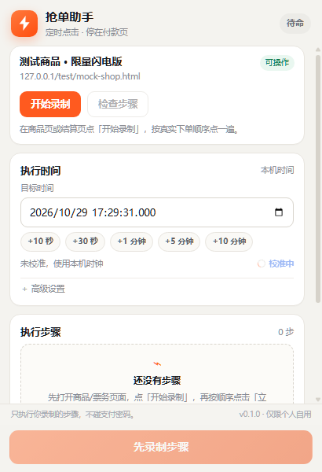
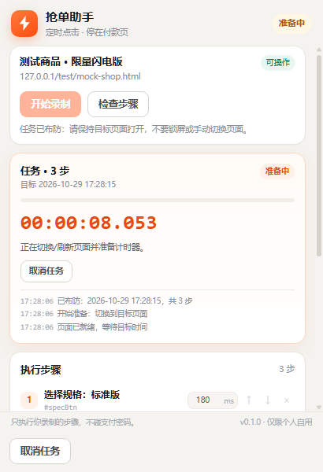
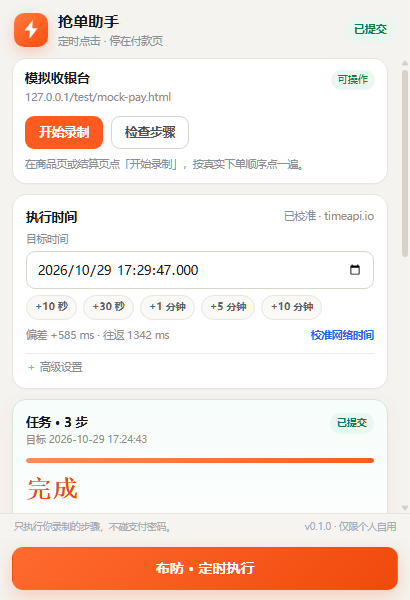
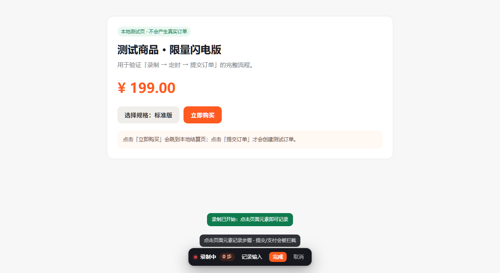

# 抢单助手 · Grab Assistant

[](https://github.com/jesse0713/grab-assistant/actions/workflows/ci.yml)
[](LICENSE)
[](extension/manifest.json)

一个在你**本机 Chrome** 里运行的轻量扩展：你先正常登录购物/票务网站，把「立即购买 → 提交订单」的点击顺序录下来，设定时间后由扩展到点自动执行，**停在付款页**，付款仍由你手动完成。

它不是爬虫，也不接管你的账号：只重放你自己录下的那几次点击，一次布防只跑一遍。

## 它解决什么

- 商品页/票务页需要卡点点击，手动容易慢半拍。
- 你已经在 Chrome 登录，不想把账号密码交给任何第三方。
- 只想自动完成「下单」，不想让工具碰支付密码。

## 特性

- **录制即配置**：不写脚本，按真实顺序点一遍就是执行步骤。
- **支付红线**：命中「支付 / 付款 / 收银台 / Pay Now」的按钮既不记录也不执行。
- **毫秒级定时**：目标时间精确到毫秒，可选校准网络时间，失败自动退回本机时钟。
- **跨页编排**：改地址、选规格、跳结算页这类多页面流程，由后台在每次跳转后接手下一步。
- **遇验证就停**：识别到验证码/滑块/安全验证时暂停并通知，等你手动处理完再点「继续执行」。
- **不循环不批量**：一次布防执行一遍即停，不做多账号、代理、批量下单。
- **纯本地**：步骤与设置只存在 `chrome.storage.local`，不上传、无遥测。

## 安全边界

这些是写死在代码里的，不是文档里的一句口号：

| 边界 | 实现位置 | 说明 |
| --- | --- | --- |
| 不点支付 | `shared/utils.js` 的支付关键词表 | 录制时拒绝，执行时二次拦截 |
| 不绕过验证 | `content/content.js` 的验证页面检测 | 命中即暂停，等待人工 |
| 不循环执行 | `background.js` 的 run 状态机 | 最后一步后立刻置为 `done` |
| 不批量/不多账号 | 无相关代码路径 | 一次布防对应一个标签页、一个订单 |
| 不破解排队风控 | 无相关逻辑 | 排队或风控页只会等待或判失败 |

仅限个人自用。请确认目标网站允许此类辅助操作，账号与订单风险由使用者自行承担。

## 界面预览

| 待录制 | 已布防 | 执行完成 |
| --- | --- | --- |
|  |  |  |

录制时页面底部的悬浮条：



## 安装

1. 打开 Chrome，地址栏输入 `chrome://extensions`。
2. 右上角开启「开发者模式」。
3. 点「加载已解压的扩展程序」，选择本仓库的 `extension` 文件夹。
4. 把「抢单助手」固定到工具栏。
5. 如果安装前已经打开了目标网页，刷新一次，让内容脚本注入。

> 需要 Chrome 114 及以上。Chrome 137 之后，官方版 Chrome 可能限制命令行 `--load-extension`，但「加载已解压的扩展程序」仍然可用。如果开发者模式被企业策略禁用，需要换一台不受管的 Chrome，或让管理员放开扩展安装权限。

本仓库不提交打包产物。想直接用现成包的话，到 [Releases](https://github.com/jesse0713/grab-assistant/releases) 下载 `v0.1.0` 的 zip，解压出一个文件夹后，用「加载已解压的扩展程序」选中它即可；源码里的 `extension` 文件夹与压缩包内容完全一致。

## 使用

### 1. 录制

1. 在 Chrome 中登录目标网站，走到开始抢购的页面（如商品详情页）。
2. 点扩展图标 →「开始录制」，页面底部出现黑色悬浮条。
3. 按真实顺序点击：「立即购买」→「提交订单」。
   - 点击「提交订单」时，扩展会记录这一步，但**拦截真实提交**，录制阶段不会产生订单。
   - 支付按钮不会被记录。
4. 点悬浮条「完成」，回到扩展查看步骤。

### 2. 检查

点「检查步骤」：只检查当前页面能匹配到的元素，不会点击。跳转后的步骤需要到对应页面再检查。

### 3. 定时

1. 选择目标时间（支持毫秒），或用「+10 秒」等快捷按钮。
2. 建议先点「校准网络时间」；失败时自动退回本机时钟。
3. 点「布防 · 定时执行」。
4. 到点后自动执行，最后一步是「提交订单」。
5. 看到「已提交」后，立即回页面确认订单并**手动付款**。

### 4. 演练

先用「+10 秒」做一次完整演练，确认每一步都能被找到，再用于真实场景。

## 本地测试

仓库自带一个模拟商城，全程本地、不会产生真实订单。

```powershell
# 1. 启动本地静态服务器（在仓库根目录）
python -m http.server 8765 --bind 127.0.0.1

# 2. 浏览器打开
# http://127.0.0.1:8765/test/mock-shop.html
```

按「录制 → 检查 → +10 秒布防」走一遍，正常结果：

- 自动从商品页跳到结算页；
- 自动点击「提交订单」；
- 跳到 `mock-pay.html` 收银台；
- 不会点击「确认支付」。

纯逻辑单元测试（无需浏览器）：

```powershell
node --test test/unit.test.mjs
```

完整的端到端测试会启动真实的 Chrome for Testing、加载扩展、录制 3 步、定时执行，并断言只创建 1 个订单、没有误点支付：

```powershell
# 需先把 Chrome for Testing 解压到 .tools/chrome-win64/chrome.exe
node test/e2e.mjs
```

E2E 依赖同目录的本地服务器（端口 8765）和 Chrome 调试端口 18080；结束后会清理测试专用的浏览器进程与临时 profile。

## 目录结构

```
extension/
  manifest.json            # MV3 清单
  background.js            # 调度、跨页面编排、暂停/失败处理
  shared/utils.js          # 选择器、文本判断、时间换算、DOM 工具
  content/content.js       # 录制悬浮层 + 页面内执行器
  popup/popup.html|css|js  # 扩展弹窗
  help.html                # 内置使用说明
  icons/                   # 图标
test/
  mock-shop.html           # 模拟商品页
  mock-checkout.html       # 模拟结算页
  mock-pay.html            # 模拟收银台
  unit.test.mjs            # 单元测试
  e2e.mjs                  # 真实浏览器端到端测试
  cdp.mjs                  # 轻量 CDP 客户端
  screenshots/             # 界面截图
tools/make_icons.py        # 图标生成脚本（Pillow）
.github/workflows/ci.yml   # CI：跑单元测试
```

## 工作方式


1. **录制**：内容脚本在捕获阶段记录点击，生成稳定选择器（id / data-testid / name / aria-label / 路径），并保存按钮文字作为兜底匹配。
2. **布防**：目标时间换算成本机时间；后台在目标前约 20 秒切回录制页面，把倒计时交给页面内的计时器。
3. **执行**：页面计时器在目标毫秒触发第一步；之后由后台在每次页面跳转后等待加载完成，再下发下一步。
4. **停止**：最后一步执行完立即停止，不循环；验证码/找不到元素/页面关闭都会暂停或失败，并保留日志。

## 权限说明

| 权限 | 用途 |
| --- | --- |
| `storage` | 保存步骤、设置与运行状态，仅在本机 |
| `tabs` | 切回录制页面、等待页面加载完成、检测跳转 |
| `scripting` | 读取目标页信息、执行「检查步骤」 |
| `alarms` | Service Worker 休眠后仍能按时唤醒 |
| `notifications` | 到点、暂停、失败时提醒 |
| `<all_urls>` | 你可以在任意站点录制，内容脚本需要能注入你打开的页面 |

## 隐私与数据

- 步骤、页面地址、按钮文字只写入 `chrome.storage.local`，不上传任何服务器。
- 唯一的外部请求是「校准网络时间」时对时间接口的一次 GET，不带任何用户数据：
  - `https://timeapi.io/api/Time/current/zone?timeZone=UTC`
  - `https://api.m.taobao.com/rest/api3.do?api=mtop.common.getTimestamp`
  - `https://worldtimeapi.org/api/timezone/Etc/UTC`
  前一个失败才试下一个，全部失败则用本机时钟。
- 不含统计、崩溃上报、远程配置。
- 不读取输入框内容（`type=password` 直接跳过），不保存登录态。

## 常见问题

**到点没执行？**
检查目标页是否被关闭/刷新/跳转、电脑是否锁屏、扩展是否被禁用。布防后尽量别动页面。

**提示「未找到」？**
页面改版或该步骤在下一页。到对应页面点「检查步骤」，或重新录制这一步。

**提示「需要人工处理」？**
出现验证码/滑块。手动完成，再回扩展点「继续执行」。

**会不会重复下单？**
一次布防只执行一遍，最后一步后停止。但手动刷新或再次布防可能产生新订单，请自行确认页面状态。

**为什么是浏览器扩展，不是桌面脚本或小程序？**
需要复用你在 Chrome 里已有的登录态。小程序跑在沙箱里碰不到这些页面；桌面自动化则要接管浏览器或模拟输入，权限过大且更易触发风控。扩展只在你已登录的标签页里重放点击，边界最小。

## 已知限制

- 依赖页面 DOM。网站改版、按钮文字变化、A/B 测试可能导致某一步找不到；重新录制该步即可。
- 无法处理需要人工操作的验证码、滑块、短信验证；会暂停等你处理。
- 强排队/强风控平台只能做到「帮你点到提交订单」，不保证抢到。
- 强实名、强排队平台通常还有登录态校验、排队和验证，本工具不适合也不保证可用；请优先遵守平台规则。
- 录制时点击会先被拦截、写入步骤后再重放，极少数检查 `event.isTrusted` 的站点可能不响应；这类站点需要单独适配。
- 如果点击后网站打开的是**新标签页**，当前版本不会自动跟过去，建议在最终结算页重新录制。
- 不支持 closed shadow DOM、跨域 iframe 内的按钮。
- 仅适配桌面版 Chrome，不支持移动端与 Firefox/Safari。

## 免责声明

本项目仅供个人学习与自用，用于减少重复点击的操作成本。请遵守目标网站的服务条款和当地法律法规，不要用于代拍、转售、批量抢购或任何规避平台风控的用途。作者不对使用本项目造成的账号受限、订单纠纷或任何损失负责。

## 许可

[MIT](LICENSE)
